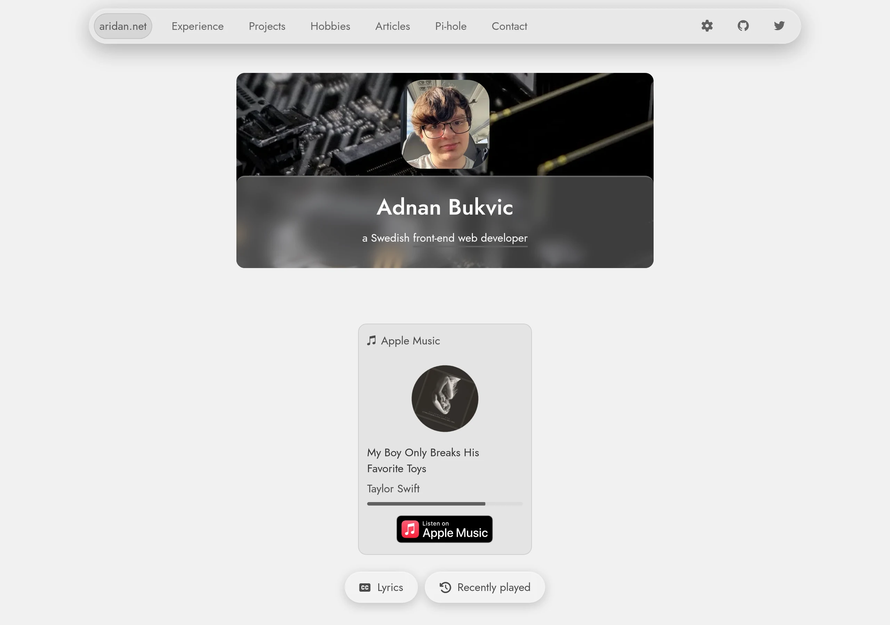
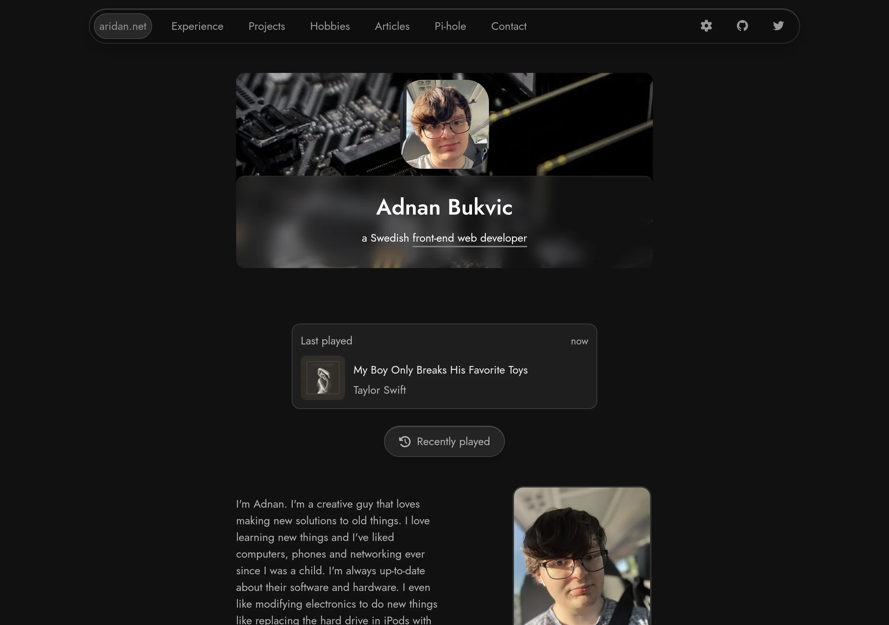
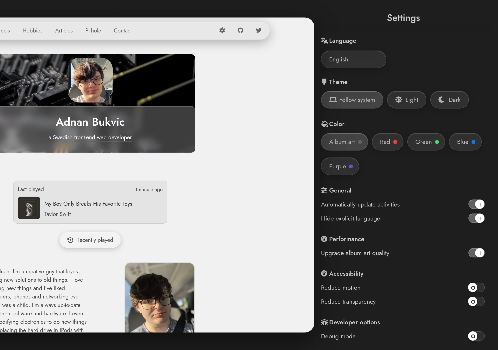
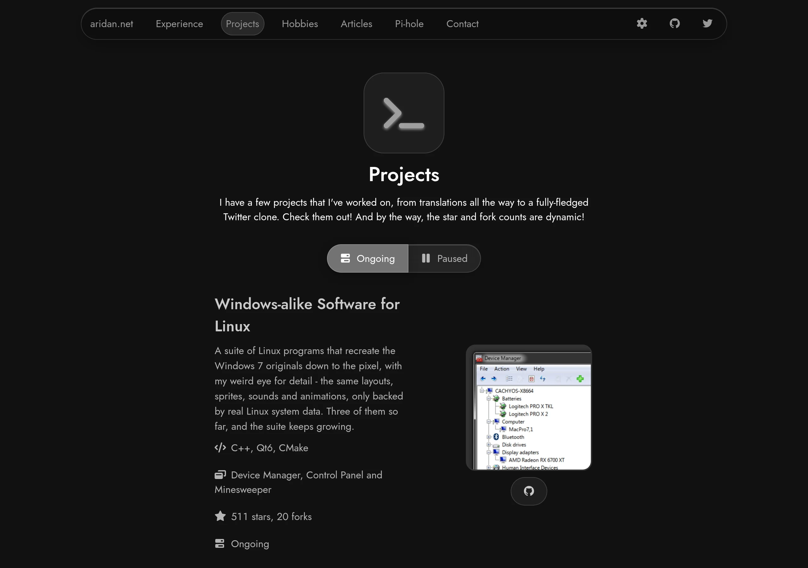
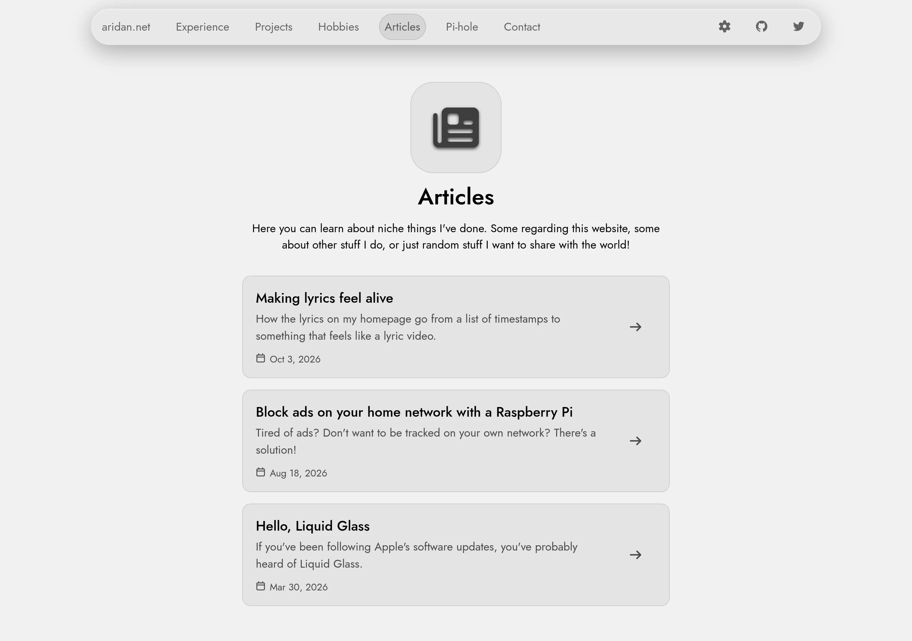
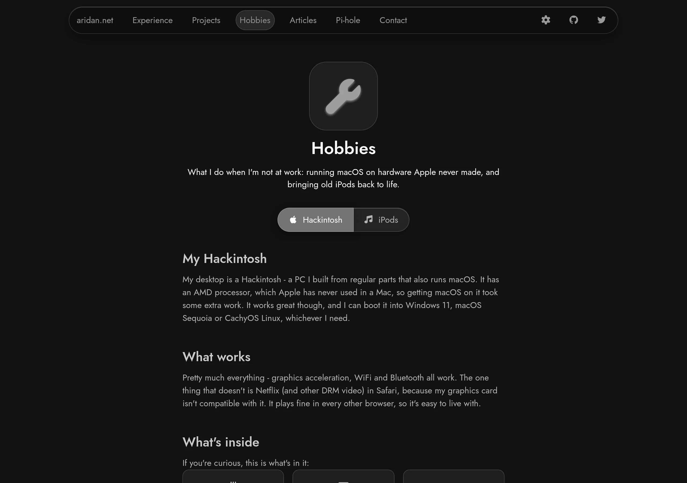
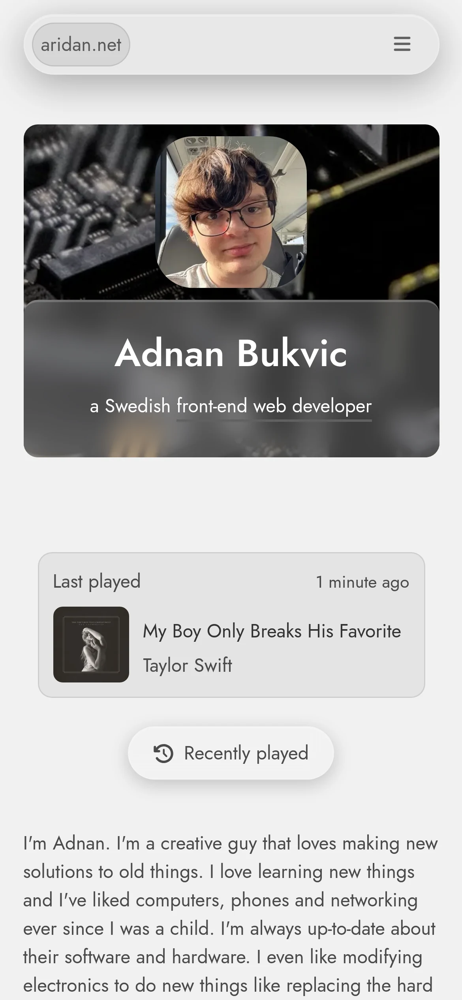
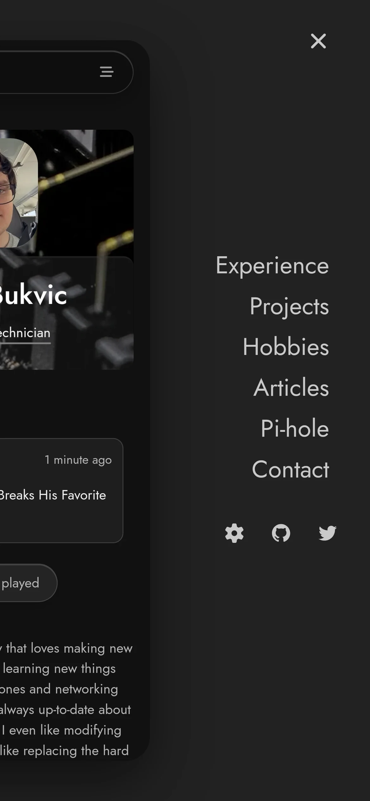
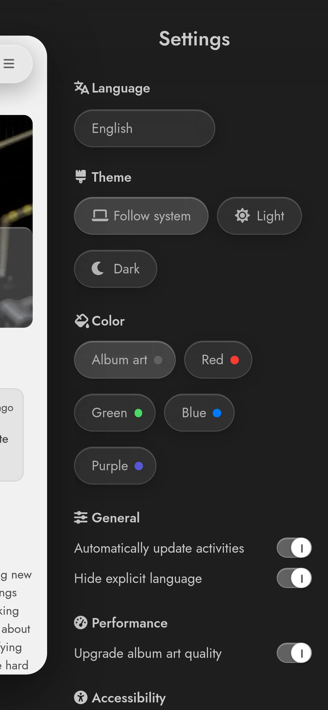

  

  # aridan.net
  <i>My personal website, at <a href="https://aridan.net">aridan.net</a></i>

  

    A modern, fast and lightweight website that can be used to show general information about a person. Supports multiple languages and follows accessibility guidelines for a more open internet.
  

 

| | | |
|:-------------------------:|:-------------------------:|:-------------------------:|
|  |  |  |
|  |  |  |
|  |  |  |

## Contributors

- Adnan Bukvic (a.k.a. aridan) / [@actuallyaridan](https://github.com/actuallyaridan)

- Slade Watkins / [@sladewatkins](https://github.com/sladewatkins)

- Dexrn ZacAttack (a.k.a Zach) / [@dexrnzacattack](https://github.com/dexrnzacattack)

- Dhiren Vasnani / [@dhirenvasnani](https://github.com/dhirenvasnani)

## Scripts

There's no build step, but a few scripts in `scripts/` help keep things in
order. They're all run by hand, and what they write is committed like any other
change, so the deploy stays exactly as it is.

- `node scripts/layout.js` - the header, menu and footer live in
  `src/partials/`, and each page marks where they go with
  `<!-- shared:header -->` comments. Edit the partial, run this, and every page
  gets the change. `--check` only reports pages that are out of date.
- `node scripts/cover.js <slug>` - draws the picture an article is shared
  with, from its title, preview and `icon:` front matter, using headless
  Chromium. Add `--icon="fa-brands fa-raspberry-pi"` to set the icon.
- `python3 scripts/placeholders.py` - makes the tiny blurred previews every
  image shows while it loads, and writes them into `src/css/styles.css`.
  Run it after adding or changing an image. Needs Pillow.
- `node scripts/vendor-prosemirror.js` - downloads ProseMirror, the engine
  under the article editor, into `src/vendor/prosemirror/`. It's self-hosted
  because jsDelivr's builds would load several copies of its core, which
  breaks it. Change a version in the script and run it to update.

## The fine print

Currently hosted using Cloudflare Pages. The files under `functions/` are
Cloudflare Pages Functions - they serve `/sitemap.xml` and `/feed.xml`, and
rewrite the metadata on article pages so shared links unfurl properly. They
don't run under a plain static server, so those three routes only work on a
real deploy or under `wrangler pages dev`.

Copyright (c) 2026 Adnan Bukvic under the MIT license
